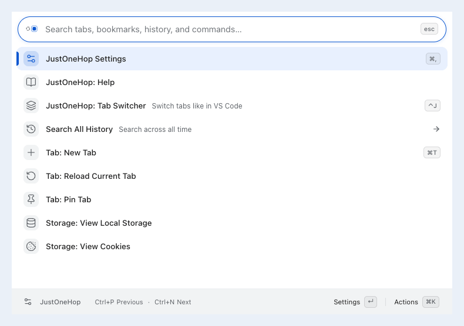
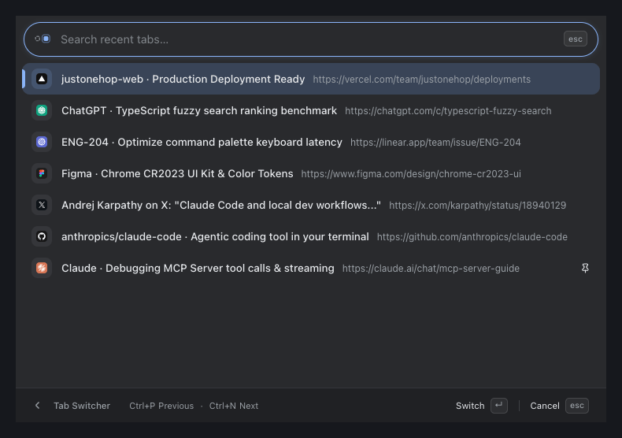
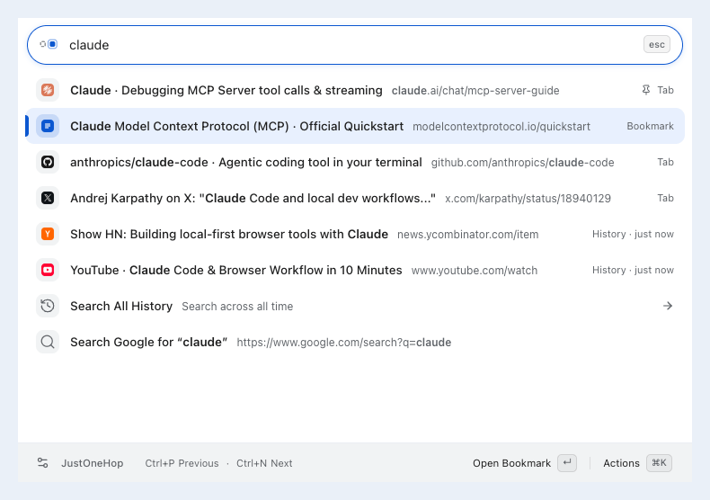

<picture>
  <source media="(prefers-color-scheme: dark)" srcset="docs/brand/logo-dark.svg">
  <source media="(prefers-color-scheme: light)" srcset="docs/brand/logo-light.svg">
  
</picture>

# JustOneHop · 小范围瞬移

English · [简体中文](README.zh-CN.md)

**A human-first, Chrome-native command palette.**
Find open tabs, bookmarks, browsing history, and browser commands from a single search box—effortless with your mouse, keyboard, or both.

> **100% Local & Private** — Runs entirely on your device. No account, no backend server, and no telemetry.
> *(Currently tested on real hardware on **macOS 26.7.1** with **Google Chrome 155.0.8059.85**.)*

---

## Why JustOneHop?

- **Human First**: Click with the mouse, use familiar shortcuts, or switch between them mid-flow. No cryptic mode prefixes (`>`, `@`, `%`) to memorize.
- **Chrome Native**: Built to feel like part of Chrome—using native Tab Groups, bookmarks, history, and favicon caches with automatic Light & Dark themes.

---

## Features

### 1. One Search Box for Everything

Press **`⌘Shift+P`** (`Ctrl+Shift+P` on Windows/Linux) or click the toolbar icon to search across **open tabs, bookmarks, recent history, tab groups, and browser actions** at once.



- **Plain words, not syntax**: Search by title or domain, or type everyday actions like `new tab`, `reopen closed tab`, `dark mode`, `downloads`, `extensions`, or `passwords` (English & Chinese supported).
- **Find the project page first**: When a query exactly matches the URL’s final path segment and appears in the title, that page ranks above title-prefix matches. Searching `justonehop` favors the repository page over its documents; adding `testing` finds the relevant document.
- **Learns your habits locally**: Relevance always comes first; for the same query, items you pick often move up naturally within their tier. Hover the history icon on any learned result to see why or forget it with one click.
- **Open bookmarks & history in place**: Click or press `Enter` to navigate the current tab; `⌘Enter` on macOS (`Alt+Enter` on Windows/Linux) opens a new active tab, just like Go to URL. The footer and Actions menu offer both choices. Pinned source tabs allow only a new tab; open-tab results still switch tabs.
- **Open URLs & Search Google**: Type `example.com` or `localhost:3000` to go straight there, or press `Enter` on any query to search Google (`⌘Enter` for a new tab).

### 2. Tab Switcher (`Alt+Tab` for Chrome Tabs)

Jump back to the tab you were just looking at—ordered by **most recently used (MRU)** in your current window.



- **Hold & release**: Hold `Control+J` (or set up **`Ctrl+Tab`** with the built-in one-step guide), tap through recent tabs, and release to switch.
- **Filter anytime**: Click the search bar or press `⌘F` while switching to pause release-to-switch and filter by title or URL.
- **Mouse-friendly**: Also available right from the home list whenever you prefer clicking.

### 3. Tidy Tabs & Quick Actions

Clean up a crowded tab strip without losing your place.



- **Continuous tab housekeeping**: Right-click any tab result or press **`⌘K`** to copy its URL, pin, mute, reload, bookmark, or close tabs. The palette stays open and selects the next item so you can tidy several tabs in a row.
- **Manage tab groups directly**: Click, press Enter, or use the “View Group Tabs” footer action to browse a group’s tabs; the Actions menu contains only group management operations. Right-click, use Actions, or press Cmd/Ctrl+K to expand/collapse, rename, ungroup while keeping all tabs, or close the entire group. Closing shows the group name and tab count for confirmation, rechecks membership, and protects pinned tabs. The member view offers the same group actions; search context is restored afterward unless the palette’s source tab was closed.
- **Auto tuck without closing pages**: Enable it in Settings and choose 1/3/12 hours or 1/3/7 days of inactivity (off by default; 7 days selected). Eligible tabs move into native collapsed groups while your computer is idle, keeping pages open. Preview candidates and check the last automatic run in Settings. Selecting a duration saves it immediately and preserves timers; turning it off returns all managed tabs, including manually tucked ones.
- **Quick Chrome pages**: Type `extensions`, `passwords`, `downloads`, or `chrome settings` to jump straight to Chrome's built-in pages (switching to an existing tab if one is already open).
- **Read-only Site Storage**: Search `local storage`, `session storage`, or `cookie` to inspect formatted JSON and copy values side by side (cookie access is requested per site).

---

## Installation

### Option 1: Chrome Web Store

The current source version is **`0.2.0`**; see the [Changelog](CHANGELOG.md) and [GitHub Releases](https://github.com/lyyourc/JustOneHop/releases). The last recorded store submission is `0.1.0` (pending review at the time). Current approval and availability have not been reconfirmed; the source version does not indicate the live store version.

- **Store Listing**: [JustOneHop on Chrome Web Store](https://chromewebstore.google.com/detail/justonehop/mbofggnjaoneioopfbpheapgphmkclbo) *(link becomes public once review completes; ID: `mbofggnjaoneioopfbpheapgphmkclbo`)*

### Option 2: Build from Source

Requires Node.js / npm and Chrome 127+.

```sh
npm ci
npm run build
```

1. Open `chrome://extensions` and enable **Developer mode** in the top right.
2. Click **Load unpacked** and select the generated **`dist/`** directory.
3. Click the JustOneHop toolbar icon or press **`⌘Shift+P`** (`Ctrl+Shift+P` on Windows/Linux).

> Need to change the shortcut? Search `shortcuts` inside JustOneHop or open `chrome://extensions/shortcuts`.

---

## Quick Shortcuts

| Action | Mouse | macOS Shortcut |
| --- | --- | --- |
| Open / close palette | Click toolbar icon / `esc` badge | `⌘Shift+P` / `Esc` |
| Select & run | Click row or primary footer button | `↑` `↓` (or `Ctrl+P` / `Ctrl+N`), then `Enter` |
| More actions on item | Right-click row or click **Actions** | `⌘K` |
| Recent Tab Switcher | Click `Tab Switcher` on home | `Control+J` (or configure `Ctrl+Tab`) |
| Open Settings | Click gear icon in footer | `⌘,` |
| View Help | Click "Help" on home or search `help` | Filter key points or jump to full GitHub guide |
| Go back one level | Click back arrow, `esc`, or swipe right with two fingers | `Esc` (or `Backspace` when search is empty) |

When a search field contains text, its trailing `esc` button turns into `×` on hover or keyboard focus. Clicking clears the search and returns focus to the input, keeping the current view open. With an empty search, the button stays `esc` and exits the current layer. The Escape key continues to exit one layer at a time.

The single-line footer keeps actions aligned to the right. Page actions use **Open Here** and **New Tab**, with full descriptions in tooltips and the Actions menu. Navigation hints hide together when space is tight; status feedback remains visible. On narrow screens, the new-tab action becomes an icon button.

Settings, copying, and tab management report their results in the footer. Language and theme changes confirm the saved option; success messages remain briefly when you type or return to the parent view. Longer operations show progress, and failures stay visible until dismissed or retried.

For step-by-step guides, gesture details, and `Ctrl+Tab` setup, see the **[Usage Guide](docs/USAGE.md)** ([中文版](docs/USAGE.zh-CN.md)).

---

## Privacy & Boundaries

- **Where it runs**: Opens as a centered overlay on regular webpages, and automatically falls back to a standalone popup window on restricted pages (such as `chrome://` or the Chrome Web Store).
- **Switching apps**: The command palette keeps your search and current view when you switch to another app. Switching away from the source tab, navigating it, or closing it ends the session. The shortcut-driven Tab Switcher still cancels on focus loss.
- **Your data stays local**: Preferences, search ranking, and group recovery records are stored only in local extension storage. Search ranking keeps up to 2,000 query–target records; records unused for 90 days expire. Inspected Storage/Cookie values are read in memory and never persisted; copied values go to your clipboard.
- **Privacy Policy**: Read the full [Privacy Policy](docs/PRIVACY.en.md) ([中文版](docs/PRIVACY.md)). Effective October 19, 2026. Developer: `lyyourc` · Contact: [liangyida42@gmail.com](mailto:liangyida42@gmail.com).

---

## Development & Docs

```sh
npm run dev     # Watch source files and rebuild incrementally
npm run check   # Run typecheck, unit tests, build, and E2E tests
```

After building local changes, search `Reload` inside the palette to reload the extension in place.

- [Usage Guide](docs/USAGE.md) ([中文版](docs/USAGE.zh-CN.md)) · [Interaction Architecture](docs/INTERACTION-ARCHITECTURE.md) · [ADR Index](docs/adr/README.md)
- [Recent Tabs](docs/RECENT-TABS.md) · [Site Storage](docs/PAGE-STORAGE.md) · [Testing Guide](docs/TESTING.md) · [Brand & Logo](docs/brand/LOGO.md)
- [Changelog](CHANGELOG.md) · [Release & Store Guide](docs/STORE-LISTING.md#5-本地打包与发布检查清单)

`npm run package:store` checks release metadata and builds the store ZIP. Follow the Testing Guide to select checks for each change; `npm run check` includes the full E2E suite.
