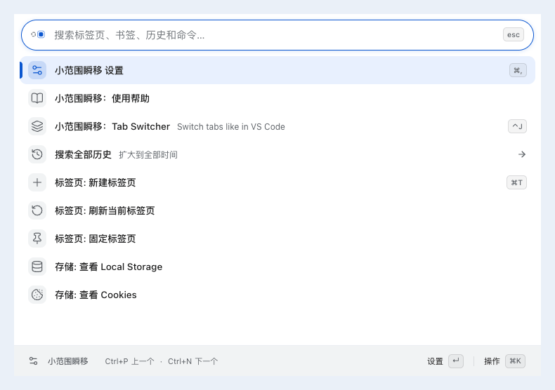
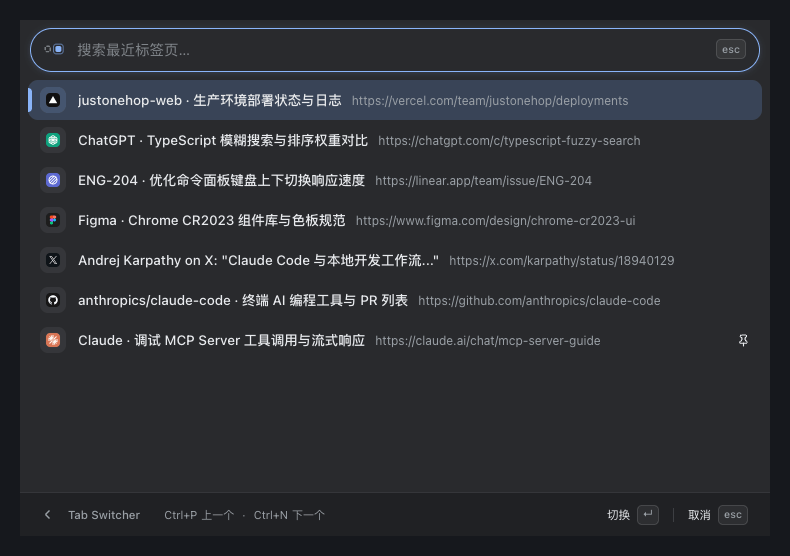
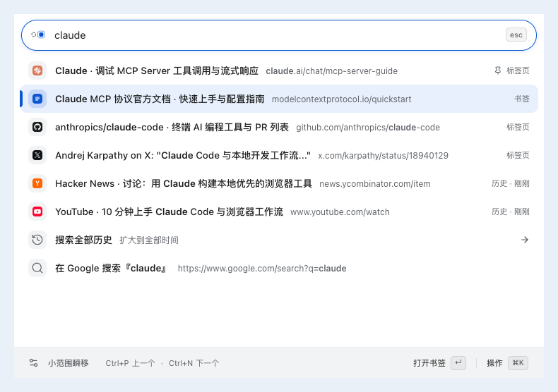

<picture>
  <source media="(prefers-color-scheme: dark)" srcset="docs/brand/logo-dark.svg">
  <source media="(prefers-color-scheme: light)" srcset="docs/brand/logo-light.svg">
  
</picture>

# 小范围瞬移 · JustOneHop

[English](README.md) · 简体中文

**顺应直觉、贴合 Chrome 原生体验的命令面板。**
在一个搜索框里同时查找已打开的标签页、书签、浏览历史和常用操作——用鼠标点选、按快捷键，或两者随时混用都很顺手。

> **100% 本地运行与隐私优先** —— 无账号、无服务端、无遥测，数据留在你的设备。
> *(目前实机测试环境：**macOS 26.7.1** + **Google Chrome 155.0.8059.85**)*

---

## 为什么做它？

- **Human First（顺应直觉）**：鼠标点击和键盘快捷键都是完整的一等公民操作路径，不需要背诵任何搜索前缀（如 `>`、`@`、`%`）或隐晦命令。
- **Chrome Native（原生自然）**：视觉遵循 Chrome CR2023 设计语言，自动适配深浅色模式；直接复用原生标签组（Tab Groups）、书签、历史记录与站点图标缓存。

---

## 核心功能

### 1. 一个搜索框，找齐所有内容

按 **`⌘Shift+P`**（Windows/Linux 为 `Ctrl+Shift+P`）或点击工具栏图标，同时检索**当前打开的标签页、收藏夹书签、最近浏览历史、标签组和浏览器操作**。



- **中英文口语直达**：搜网页标题、域名，或直接输入 `刷新页面`、`恢复标签`、`深色模式`、`下载`、`扩展`、`密码`、`new tab` 等日常表达即可执行。
- **优先找到项目本身**：搜索词完整匹配 URL 最后一个路径段、且标题包含该名称时，优先于标题前缀匹配。搜 `justonehop` 优先找到仓库首页，补上 `testing` 则查找对应文档。
- **越用越顺手的本地排序**：相关性永远优先；同一搜索词下你常选的结果会在同级内自然前移。点击右侧小图标可随时查看前移原因或一键忘记偏好。
- **书签与历史原地打开**：单击或 `Enter` 在当前标签页跳转；macOS `⌘Enter`（Windows/Linux `Alt+Enter`）新开并激活标签页，与 Go to URL 一致。底栏和操作菜单提供两种打开方式；固定来源页只允许新开，已有标签页结果仍执行切换。
- **网址直达与 Google 搜索**：输入 `example.com` 或 `localhost:3000` 直接跳转；输入任意词按 `Enter` 在当前页 Google 搜索（`⌘Enter` 在新标签页打开）。

### 2. Tab Switcher（像 `Alt+Tab` 一样切回刚才的网页）

按**最近访问顺序（MRU）**排列当前窗口的标签页，不再眯着眼在几十个小标签里来回找。



- **按住选、松手即切**：按住 `Control+J`（或按内置指南一步配置为 **`Ctrl+Tab`**），连续按键或用方向键挑选，松开修饰键立即切换。
- **随时打字筛选**：切换途中点击搜索框或按 `⌘F`，即可暂停松键切换，输入标题或网址快速缩小范围。
- **纯鼠标也好用**：随时可从命令面板首页点进 `Tab Switcher`，用鼠标或回车从容选择。

### 3. 连续整理标签页与快捷工具

一次清理多个标签页不中断，把拥挤的标签栏理得干干净净。



- **右键或 `⌘K` 连续整理**：在任意标签页结果上打开操作菜单，一键复制链接、固定、静音、刷新、收藏／取消收藏或关闭标签页。操作后面板保持打开并自动选中下一项，方便一路整理到底。
- **直接管理标签组**：单击／Enter 或底栏「查看组内标签页」进入组；操作菜单只保留组管理动作。右键、底栏「操作」或 Cmd/Ctrl+K 直接展开／折叠、改名、解散分组（保留所有标签页）或关闭整个组。整组关闭先显示组名与标签页数量供确认，执行前重新核对成员并保护固定页。详情页保留同样的组级操作，完成后恢复搜索上下文；若关闭了面板来源页，本次面板随之结束。
- **自动收起，保留页面**：默认关闭，可在设置中开启并选择 1／3／12 小时、1／3／7 天的闲置时长，默认 7 天。电脑空闲时将符合条件的标签页移入原生折叠组，页面保持打开；设置中可预览候选并查看上次自动检查。选择时长后立即保存并保留已有计时；关闭会移回所有仍受管理的页面，包括手动收起页。
- **Chrome 内置页直达**：输入 `扩展`、`密码`、`下载` 或 `chrome settings`，快速跳转到对应的 Chrome 原生管理页（已打开时直接切过去，不重复开页）。
- **只读查看网站存储**：搜索 `local storage`、`session storage` 或 `cookie`，左右分栏查看当前网页键值并自动格式化 JSON，`Enter` 一键复制（Cookie 权限仅按当前站点独立申请）。

---

## 安装方式

### 方式一：Chrome 应用商店

当前源码版本为 **`0.2.0`**，变化见 [更新日志](CHANGELOG.md)，发布包见 [GitHub Releases](https://github.com/lyyourc/JustOneHop/releases)。最近的商店提交记录为 `0.1.0`（当时处于审核中）；当前审核结果与可用状态尚未重新确认，源码版本不代表商店线上版本。

- **商店主页**：[Chrome Web Store · 小范围瞬移](https://chromewebstore.google.com/detail/justonehop/mbofggnjaoneioopfbpheapgphmkclbo) *(审核通过后即可直接访问安装；扩展 ID：`mbofggnjaoneioopfbpheapgphmkclbo`)*

### 方式二：本地构建安装

需要 Node.js / npm 与 Chrome 127+。

```sh
npm ci
npm run build
```

1. 打开 `chrome://extensions`，开启右上角 **「开发者模式」**。
2. 点击 **「加载已解压的扩展程序」**，选择构建生成的 **`dist/`** 目录。
3. 点击工具栏图标，或按 **`⌘Shift+P`**（Windows/Linux 为 `Ctrl+Shift+P`）唤起面板。

> 如需修改唤起快捷键，可在面板内直接搜索「快捷键」，或打开 `chrome://extensions/shortcuts`。

---

## 常用操作速查

| 操作 | 鼠标操作 | macOS 快捷键 |
| --- | --- | --- |
| 打开 / 关闭面板 | 点击工具栏图标 / 搜索框右侧 `esc` | `⌘Shift+P` / `Esc` |
| 选择并执行结果 | 直接点击结果行或底栏主按钮 | `↑` `↓`（或 `Ctrl+P` / `Ctrl+N`），`Enter` 执行 |
| 更多操作（复制链接、固定、静音等） | 右键结果行，或点击底栏「操作」 | `⌘K` |
| 最近标签页切换 | 首页点击 `Tab Switcher` | `Control+J`（可配置 `Ctrl+Tab`） |
| 打开设置 | 点击底栏左侧齿轮 | `⌘,` |
| 查看使用帮助 | 首页点击「使用帮助」或搜索 `help` | 支持要点检索与一键跳转 GitHub 完整指南 |
| 返回上一层 | 点击底栏返回箭头、`esc` 或触控板双指右滑 | `Esc`（二级页空搜索框也可按 `Backspace`） |

有搜索内容时，尾部的 `esc` 按钮在鼠标悬停或键盘聚焦时变为 `×`，点击只清空搜索并恢复输入焦点，保留当前视图。搜索为空时保留 `esc`，点击退出当前层；键盘 Esc 始终逐层退出。

底栏保持单行，操作区固定靠右；页面操作显示「当前页打开」「新标签页打开」（英文 **Open Here / New Tab**），悬浮说明与操作菜单保留完整描述。空间不足时导航提示整组隐藏，状态反馈继续显示；窄屏的新开操作显示为图标按钮。

设置、复制与标签整理会在底栏提示实际结果。语言和主题切换明确确认已保存的选项；继续输入或返回上层时，成功提示仍短暂保留。耗时操作显示执行中，失败提示保留至关闭或重试。

更多手势说明、排序细节与 `Ctrl+Tab` 配置方式，请查看 **[使用指南](docs/USAGE.zh-CN.md)**（[English](docs/USAGE.md)）。

---

## 隐私与使用边界

- **承载方式**：普通网页以居中浮层展示；在 Chrome 内置页、应用商店等限制脚本注入的页面，自动切换为跟随当前页位置的独立窗口。
- **切换应用**：临时切到其他应用时，命令面板保留搜索词与当前视图；切走来源标签页、来源页导航或关闭时结束会话。快捷键启动的 Tab Switcher 仍在失焦时取消。
- **本地数据**：偏好设置、搜索排序记录与标签组恢复记录仅保存在本机扩展存储中。搜索排序最多保留 2000 条「搜索词 + 目标」记录，90 天未使用的记录失效。查看的网页 Storage / Cookie 仅在内存中只读展示，不写入持久存储；主动复制的内容会进入系统剪贴板。
- **隐私政策**：详见 [中文隐私政策](docs/PRIVACY.md)（[English](docs/PRIVACY.en.md)），自 2026-10-19 起生效。开发者：`lyyourc` · 联系邮箱：[liangyida42@gmail.com](mailto:liangyida42@gmail.com)。

---

## 开发与文档

```sh
npm run dev     # 监听源码并增量构建
npm run check   # 运行类型检查、单元测试、构建与端到端测试
```

本地修改并构建后，可在面板中直接搜索 `Reload` 或 `重新加载扩展` 原地重载。

- [使用指南](docs/USAGE.zh-CN.md)（[English](docs/USAGE.md)） · [交互架构](docs/INTERACTION-ARCHITECTURE.md) · [ADR 架构决策](docs/adr/README.md)
- [最近标签切换](docs/RECENT-TABS.md) · [页面存储查看](docs/PAGE-STORAGE.md) · [测试指南](docs/TESTING.md) · [Logo 规范](docs/brand/LOGO.md)
- [更新日志](CHANGELOG.md) · [版本发布与商店指南](docs/STORE-LISTING.md#5-本地打包与发布检查清单)

`npm run package:store` 会检查发布元数据并生成商店 ZIP。按测试指南选择每次改动的验证范围；`npm run check` 包含全量端到端测试。
