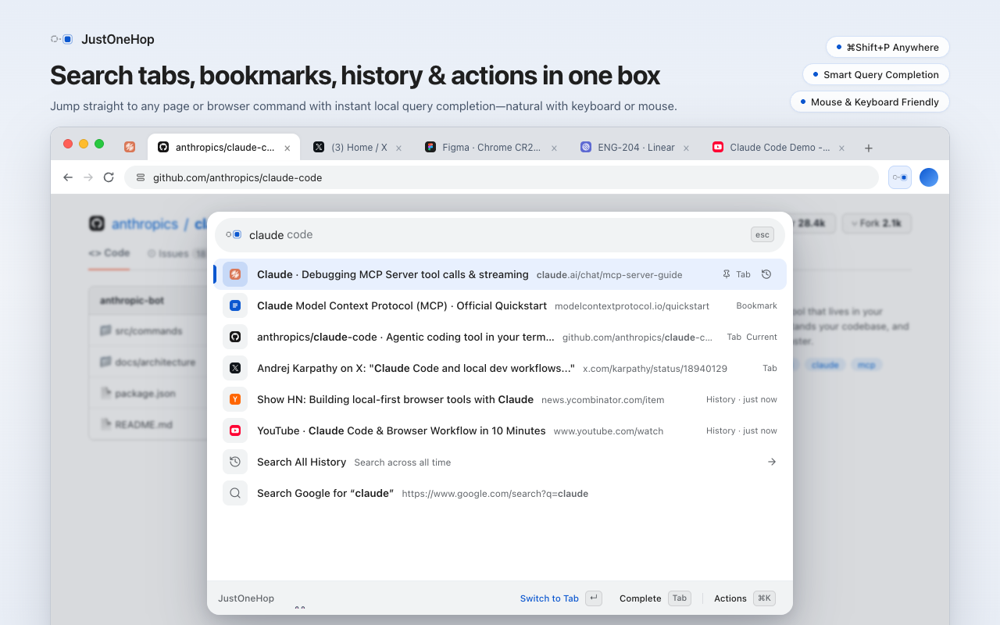
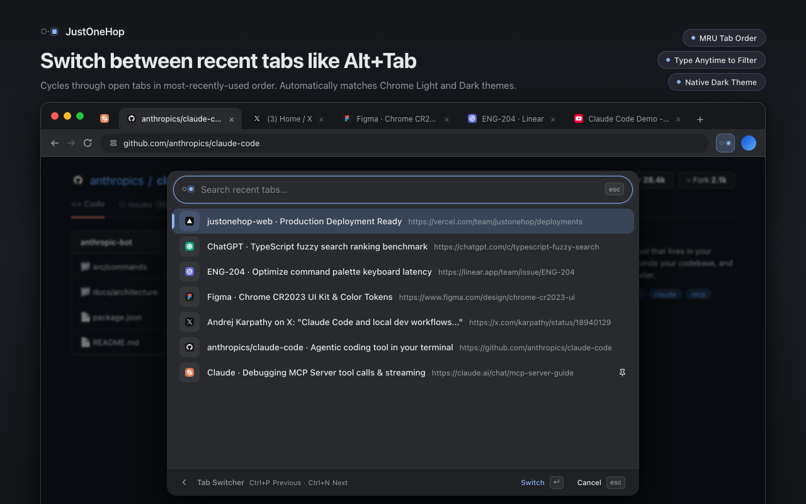
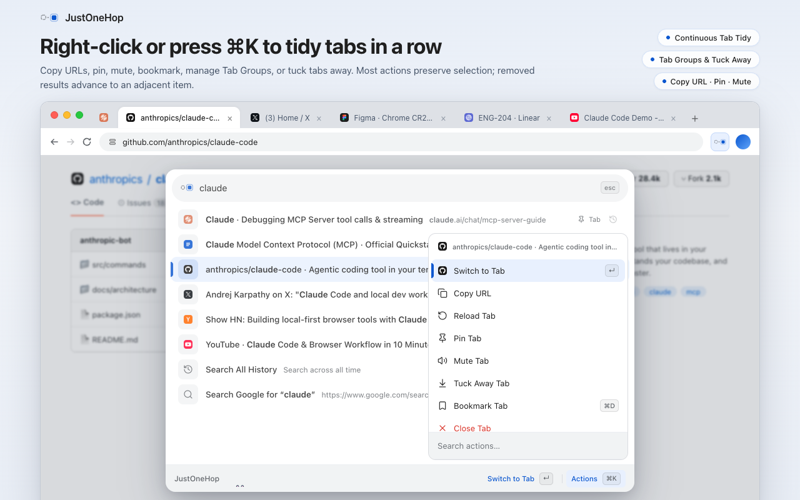

# JustOneHop User Guide

English · [简体中文](USAGE.zh-CN.md) · [Back to README](../README.md)

Welcome to the **JustOneHop** (小范围瞬移) User Guide! JustOneHop is a human-first, Chrome-native command palette designed to make tab navigation, switching, decluttering, and site inspection fast and pleasant.

Whether you prefer the speed of keyboard shortcuts, the comfort of your trackpad/mouse, or switching fluidly between both, JustOneHop meets you right where you are.

---

## Table of Contents

- [1. Quick Start](#1-quick-start)
- [2. Unified Search: Find Anything in One Hop](#2-unified-search-find-anything-in-one-hop)
  - [Search Tabs, Bookmarks & History](#search-tabs-bookmarks--history)
  - [Real-World Query Examples](#real-world-query-examples)
  - [Smart Aliases & Typo Tolerance](#smart-aliases--typo-tolerance)
  - [Instant URL Navigation & Google Search](#instant-url-navigation--google-search)
- [3. Tab Switcher: Recent Tabs like VS Code](#3-tab-switcher-recent-tabs-like-vs-code)
  - [Hold, Cycle, and Release](#hold-cycle-and-release)
  - [Setting Up Ctrl+Tab in 10 Seconds](#setting-up-ctrltab-in-10-seconds)
  - [Filter Tabs on the Fly](#filter-tabs-on-the-fly)
- [4. Tab Housekeeping & Quick Actions (`⌘K`)](#4-tab-housekeeping--quick-actions-k)
  - [Continuous Multi-Tab Tidy](#continuous-multi-tab-tidy)
  - [Manage Native Tab Groups](#manage-native-tab-groups)
  - [Instant Bookmarking (`⌘D`)](#instant-bookmarking-d)
- [5. Tab Tucking: Declutter without Closing](#5-tab-tucking-declutter-without-closing)
  - [Manual Tucking](#manual-tucking)
  - [Automatic Idle Tucking](#automatic-idle-tucking)
  - [Restoring & Undoing](#restoring--undoing)
- [6. Developer Inspection: LocalStorage, SessionStorage & Cookies](#6-developer-inspection-localstorage-sessionstorage--cookies)
  - [Two-Pane Side-by-Side Preview](#two-pane-side-by-side-preview)
  - [Permissions & Privacy](#permissions--privacy)
- [7. Navigation, Gestures & Panel Placement](#7-navigation-gestures--panel-placement)
  - [The 44px Footer & Breadcrumbs](#the-44px-footer--breadcrumbs)
  - [Multi-Level Back & Trackpad Swiping](#multi-level-back--trackpad-swiping)
  - [In-Page Overlay vs. Dedicated Window](#in-page-overlay-vs-dedicated-window)
- [8. Local Learning & Habit Memory](#8-local-learning--habit-memory)
- [9. Complete Keyboard & Mouse Shortcuts](#9-complete-keyboard--mouse-shortcuts)

---

## 1. Quick Start

<a id="使用帮助"></a>

### Summon the Palette

Press **`⌘Shift+P`** on macOS or **`Ctrl+Shift+P`** on Windows/Linux anywhere in your browser (or simply click the JustOneHop icon in your Chrome toolbar).

```
macOS:         ⌘ + Shift + P
Windows/Linux: Ctrl + Shift + P
```

<picture>
  
</picture>

### What You See When Opened

When you open JustOneHop without typing anything, you are greeted by the **Home View**—a curated list of useful entry points and recent favorites:

- **Tab Switcher**: Jump straight to your most recently used tabs.
- **Search All History**: Search beyond the past 7 days across your full browsing history.
- **Quick Controls**: Access Settings, built-in Help, New Tab, Reload, or Pin/Mute.
- **Storage Viewers**: Instant access to Local Storage, Session Storage, and Cookies.

> [!TIP]
> **Need help or want to rebind shortcuts?**
> Right-click the JustOneHop icon in the Chrome toolbar at any time to check your active keyboard shortcut or open the built-in Help page.

---

## 2. Unified Search: Find Anything in One Hop

<a id="搜索与导航"></a>

Whether searching open tabs, bookmarks, history, or browser settings, simply type the words in your head—JustOneHop handles everyday phrases and common aliases naturally:


### Search Tabs, Bookmarks & History

- **Open Tabs**: Type a word from the title or domain, press `Enter`, and hop straight there.
- **Bookmarks**: Matched seamlessly alongside open tabs. Press `Enter` to navigate in the current tab, or press **`⌘Enter`** (`Alt+Enter` on Windows/Linux) to open in a new active tab.
- **Browsing History**: Automatically searches the past 7 days. Need older pages? Select **Search All History** (always available at row #7 or by typing `history`).
- **Chrome Built-in Pages**: Type `extensions`, `passwords`, `downloads`, `bookmarks`, or `chrome settings` to jump directly to Chrome's native management pages.

### Real-World Query Examples

| What you want to do | What to type | What happens |
| --- | --- | --- |
| Jump to a pull request | `github pull` or `pr review` | Matches open GitHub tabs and recent history |
| Find a Notion page | `notion roadmap` | Combines domain and page title |
| Open a bookmark | `react docs` | Matches folder or bookmark title |
| Switch themes | `dark mode` or `theme` | Navigates directly into Settings → Appearance |
| Recover an accidentally closed tab | `reopen` or `undo close` | Restores the most recently closed tab or window |
| Tidy open tabs | `close tabs to the right` | Safely closes eligible tabs to the right |

Chinese content also supports **toneless pinyin and consecutive initials**: type `chanpinluxiantu`, `cplxt`, or `notion luxian` to find “产品路线图”. Use at least two letters, separate mixed Chinese, English, pinyin, and number terms with spaces, and type `v` for `ü`. Literal matches stay ahead of phonetic matches regardless of learned preferences. Tab Switcher supports the same matching and highlights the original Chinese characters.

History keeps Chrome's literal search and supplements it with pinyin matches from the latest 1,000 pages in the selected time range. A notice appears when the search reaches its limit; use the original Chinese text to find older pages.

#### Exact Project Matching

When you type a project name like `justonehop`, JustOneHop recognizes when the word matches the final path segment of a URL. It prioritizes the repository root over deeper subpages. When you want a specific document, simply add another keyword like `justonehop testing`.

### Complete a Previous Query

After successfully using a query such as `github`, type `g` in the main search to see the remaining letters as a faint hint. Suggestions come from successful local selections, URL navigation, and web searches, with frequency and recency taken into account.

- Press **Tab** or **→** at the end of the input, or click **Complete** in the footer, to fill the suggested query and keep typing.
- **Continue Search**: After opening a tab, bookmark, or history result from a nonempty main search with at least two distinct available pages, reopening within 10 minutes in the same browser window suggests that query even when the input is empty. Accept with the usual completion keys or the footer’s **Continue Search** button. Matching prefixes prioritize it; unrelated input uses normal completion. Only the latest qualifying query per window is retained, until expiry, reset, or browser restart. Commands, direct URL navigation, Google searches, and incognito do not create this hint.
- Until accepted, results match only what you typed. **Enter** still executes the selected result; **↑ / ↓** only changes the selected result.
- Without a hint, Tab moves focus as usual; **Shift+Tab** always moves focus backward. Moving the caret, selecting text, composing with an IME, or deleting text keeps completion out of the way.
- Suggestions stay on-device, exclude destructive commands, and are disabled in incognito. **Settings → Reset Ranking** clears the shared query and ranking history. Merely typing or accepting a hint does not save a query.

### Smart Aliases & Typo Tolerance

People type fast, and typos happen. JustOneHop includes a built-in alias dictionary for common browser actions:

- **Settings**: `prefs`, `setings`, `options`
- **Passwords**: `pwd`, `passowrd`
- **Extensions**: `plugins`, `addons`, `extention`
- **Bookmarks**: `favorites`, `favourites`
- **History**: `histroy`, `recent`
- **Reload**: `refesh`, `relaod`
- **Brand Names**: `joh`, `justonehop`, `小范围瞬移`

> [!NOTE]
> Typo tolerance is strictly curated for browser commands and aliases. Dangerous destructive commands (such as closing tabs) always require explicit intent so you never trigger them accidentally.

### Instant URL Navigation & Google Search

Type a full or partial web address (such as `github.com/trending` or `localhost:3000`), and JustOneHop turns it into a direct navigation card at the top of the list:

- Press **`Enter`** (or click **Open Here** in the footer) to navigate the current tab.
- Press **`⌘Enter`** on macOS or **`Alt+Enter`** on Windows/Linux to open in a **new background/active tab**.

If your query doesn't match local items, JustOneHop offers **Search Google for "…"**:
- Press **`Enter`** to search in place.
- Press **`⌘Enter`** / **`Alt+Enter`** to search in a new tab.

---

## 3. Tab Switcher: Recent Tabs like VS Code

<a id="最近标签页切换"></a>

If you love the `Ctrl+Tab` or `Alt+Tab` workflow in code editors like VS Code, you'll feel right at home with the **Tab Switcher**.

<picture>
  
</picture>

### Hold, Cycle, and Release

1. **Press and hold the modifier key** (default: `Control` on macOS, `Ctrl` on Windows/Linux).
2. **Tap the trigger key** (`J` on macOS, `,` on Windows/Linux; or configured to `Tab`) to open the switcher. The previous tab is selected immediately.
3. Keep holding the modifier and tap the trigger key (or use `↑`/`↓`, `P`/`N`) to cycle through recent tabs in **MRU (Most Recently Used)** order.
4. **Release the modifier key** to switch!


### Setting Up Ctrl+Tab in 10 Seconds

<a id="ctrltab-配置"></a>

Chrome reserves `Ctrl+Tab` by default and does not allow extensions to bind it directly in the normal extension shortcut UI. JustOneHop provides a clever 1-step setup helper:

1. Open JustOneHop, type `ctrl tab`, and press `Enter` (or go to **Settings → Keyboard → Tab Switcher**).
2. Click **Copy & Open** in the footer. JustOneHop automatically copies the one-line configuration script tailored to your extension ID and opens `chrome://extensions/shortcuts`.
3. Press **`⌘⌥J`** on macOS (or **`Ctrl+Shift+J`** on Windows/Linux) to reveal Chrome's DevTools Console.
4. Paste and press `Enter`. Both `Ctrl+Tab` and `Ctrl+Shift+Tab` are configured instantly!

> [!TIP]
> The setup guide remains open on the original tab, so you can switch back and forth while setting it up without losing your place.

### Filter Tabs on the Fly

Need to jump to a tab from 20 steps ago? While holding the shortcut, simply click into the top search box or press **`⌘F`** (`Ctrl+F`). 

This immediately pauses "release-to-switch", letting you release the modifier and type freely to filter tabs by title or URL. When found, press `Enter` to switch.

---

## 4. Tab Housekeeping & Quick Actions (`⌘K`)

<a id="整理标签页与继续操作"></a>

Most command palettes disappear the moment you perform an action. JustOneHop is built for **continuous tab housekeeping**:


### Continuous Multi-Tab Tidy

Right-click any item in the search list, click **Actions** in the bottom bar, or press **`⌘K`** (`Ctrl+K` on Windows/Linux) to open the contextual action menu:

<picture>
  
</picture>

From here, you can:
- **Pin / Unpin**
- **Mute / Unmute**
- **Reload Tab**
- **Copy URL** (copies clean URL without closing the palette)
- **Close Tab** (or Close Other Tabs / Close Tabs to the Right)
- **Add / Remove from Tab Group**

> [!IMPORTANT]
> **Why it's called Continuous Housekeeping:**
> When you close, pin, or mute a tab that isn't your current active tab, **JustOneHop stays open** and smoothly selects the adjacent item. You can close or pin 5 tabs in a row without reopening the palette!

### Manage Native Tab Groups

JustOneHop integrates seamlessly with Chrome's native Tab Groups:

- Search any group by its name.
- Press `Enter` or click **View Group Tabs** in the footer to inspect and search only members of that group.
- In the Actions menu (`⌘K`), you can:
  - **Expand / Collapse** the group.
  - **Rename** the group with live feedback.
  - **Ungroup (Keep Tabs)**: Dissolves the group while keeping all tabs intact.
  - **Close Group**: Closes the entire group with a protective confirmation dialog displaying the exact number of tabs to be closed (pinned tabs are always protected).

### Instant Bookmarking (`⌘D`)

<a id="收藏与取消收藏标签页"></a>

- In the search bar, type `bookmark tab` or `bookmark` to bookmark the current tab into Chrome's native bookmarks.
- In any tab result's Action menu (`⌘K`), press **`⌘D`** (`Ctrl+D`) to bookmark that specific tab without having to switch to it first.
- Search `unbookmark` to safely remove existing bookmarks.

---

## 5. Tab Tucking: Declutter without Closing

<a id="收起标签页"></a>

We all hoard tabs because we "might need them later", slowing down Chrome and cluttering the tab strip. **Tab Tucking** solves this by sliding tabs into a neat, native collapsed tab group (e.g. `Tucked · 5`) without closing them or losing form states.

### Manual Tucking

- Type `tuck tab` in the search box to tuck away your current tab.
- Or select any tab in the list, press `⌘K`, and choose **Tuck Tab**.

### Automatic Idle Tucking

Go to **Settings → Experimental Features → Auto-tuck tabs**:

- Choose an idle duration threshold: **1 hour, 3 hours, 12 hours, 1 day, 3 days, or 7 days** (default: 7 days).
- Runs gently in the background **only when your computer is idle** (at least 60 seconds of zero user activity).
- **Safety first**: Never touches pinned tabs, playing audio, active tabs, split screens, or incognito tabs.
- Turning the switch off immediately moves all tucked tabs back to your normal tab strip.

### Restoring & Undoing

- **Pick a single tab**: Simply search for the page in JustOneHop or the Tab Switcher and hop to it. It automatically untucks itself back to your active tab strip!
- **Undo the entire batch**: Type `undo tuck` to immediately restore the last tucked batch.

---

## 6. Developer Inspection: LocalStorage, SessionStorage & Cookies

<a id="页面存储"></a>

Front-end developers and power users often open the heavy Chrome DevTools just to check a cookie value or copy a JWT token from LocalStorage. JustOneHop provides a lightning-fast, read-only viewer right from the palette:

```
Search: local storage
Search: session storage
Search: cookie
```

### Two-Pane Side-by-Side Preview

- **Left Pane**: Clean, searchable list of storage keys or cookie names.
- **Right Pane**: Instant preview of the formatted JSON, raw string, and cookie metadata (domain, path, expiration, HttpOnly, partition status).
- Press **`Enter`** or click **Copy Value** in the footer to copy the clean raw value directly to your clipboard.

### Permissions & Privacy

- `localStorage` and `sessionStorage` use Chrome's temporary `activeTab` permission.
- Cookie reading requests access **strictly on a per-site basis** when you choose to open the cookie viewer for that domain.
- Values are read purely in memory for your inspection—nothing is ever stored or uploaded.

---

## 7. Navigation, Gestures & Panel Placement

<a id="面板位置底栏与返回"></a>

JustOneHop is crafted with obsessive attention to UI ergonomics.

### The 44px Footer & Breadcrumbs

At the bottom of every view sits an elegant 44px footer:
- **Left**: Clear breadcrumbs showing where you are (`Home > Settings > Appearance`), along with a clickable Back arrow.
- **Right**: Contextual actions matching your current selection (e.g. `Open Here`, `New Tab`, `Actions (⌘K)`).

### Multi-Level Back & Trackpad Swiping

Navigating deep menus shouldn't feel like a trap:
- Press **`Esc`** or click the back arrow to retreat exactly one level, perfectly restoring your previous query, cursor position, and scroll offset.
- When the search box is empty, pressing **`Backspace`** also navigates back one level.
- **Two-Finger Trackpad Swipe (macOS)**: Swipe right with two fingers on your trackpad to smoothly slide back to the previous screen.

### In-Page Overlay vs. Dedicated Window

JustOneHop automatically chooses the best display mode based on the current page:
1. **In-Page Overlay**: On standard web pages, the panel sits horizontally centered near the top of the page viewport.
2. **Dedicated Window**: On pages where Chrome forbids script injection (such as `chrome://` settings, the Chrome Web Store, or blank tabs), JustOneHop opens a lightweight companion window with its content horizontally centered near the top of the source browser window.

The command palette and Tab Switcher share these rules. Each mode uses its own anchor, so their screen positions can differ; neither uses a fixed position on the display. Content size adapts to the source tab's viewport and page zoom, with the native title bar and borders taking additional space.

---

## 8. Local Learning & Habit Memory

The more you use JustOneHop, the more attuned it becomes to your habits:

- When you search for a term and select an item, JustOneHop remembers your preference.
- Next time you type that term, that item gently moves up **within its relevance tier** (relevance always comes first—a loose URL match will never jump ahead of an exact title match).
- **Clear & Transparent**: Any item promoted by local learning displays a subtle clock icon on the right. Hover over it to see why it ranked higher, click the `×`, or press **`Shift+Backspace`** to forget that preference instantly.
- **100% On-Device**: Learning weights decay over 14 days and expire after 90 days. No usage data ever leaves your computer.

---

## 9. Complete Keyboard & Mouse Shortcuts

### Global & Palette Navigation

| Action | Mouse | macOS Shortcut | Windows / Linux |
| --- | --- | --- | --- |
| **Open / Close Palette** | Click toolbar icon | `⌘ + Shift + P` | `Ctrl + Shift + P` |
| **Close or Step Back** | Click Back arrow / `esc` badge | `Esc` (or `Backspace` if search empty) | `Esc` (or `Backspace`) |
| **Select Next / Previous** | Scroll or click row | `↓` / `↑` (or `Ctrl+N` / `Ctrl+P`) | `↓` / `↑` (or `Ctrl+N` / `Ctrl+P`) |
| **Jump to Top / Bottom** | Click top/bottom | `⌘ + ↑` / `⌘ + ↓` | `Ctrl + Home` / `Ctrl + End` |
| **Page Up / Page Down** | Scroll wheel | `⌥ + ↑` / `⌥ + ↓` (or `PageUp`/`Down`) | `Alt + ↑` / `Alt + ↓` |
| **Execute Selected Item** | Click row | `Enter` | `Enter` |
| **Open in New Tab** | Click "New Tab" in footer | `⌘ + Enter` | `Alt + Enter` |
| **Open Actions Menu** | Right-click row / Click "Actions" | `⌘ + K` | `Ctrl + K` |
| **Open Settings** | Click gear icon in footer | `⌘ + ,` | `Ctrl + ,` |
| **Forget Search Preference** | Click `×` on history badge | `Shift + Backspace` | `Shift + Backspace` |
| **Swipe Back (Trackpad)** | Two-finger swipe right | — | — |

### Tab Switcher

| Action | Mouse | macOS Shortcut | Windows / Linux |
| --- | --- | --- | --- |
| **Trigger Switcher** | Click "Tab Switcher" on Home | Hold `Control` + press `J` | Hold `Ctrl` + press `,` |
| **Cycle Recent Tabs** | Click candidate | Tap trigger key / `↓` / `↑` / `N` / `P` | Tap trigger key / `↓` / `↑` / `N` / `P` |
| **Confirm & Switch** | Click candidate | Release modifier key | Release modifier key |
| **Cancel Switch** | Click outside or `esc` | `Esc` | `Esc` |
| **Search / Filter Tabs** | Click search bar | `⌘ + F` | `Ctrl + F` |

---

*Thank you for using JustOneHop! If you encounter any issues or have ideas for improvement, feel free to open an issue on [GitHub](https://github.com/lyyourc/JustOneHop).*
