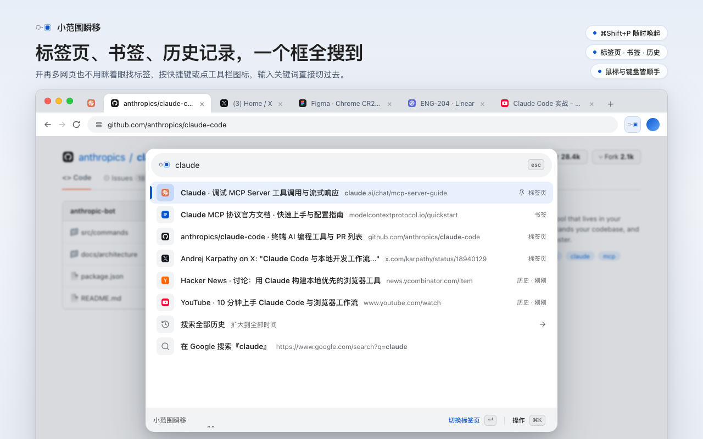
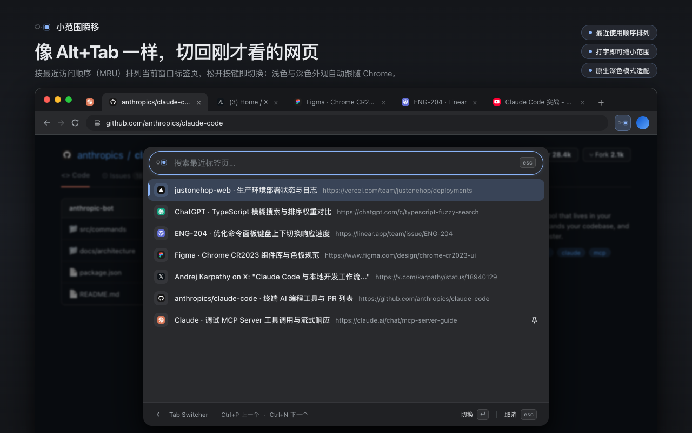
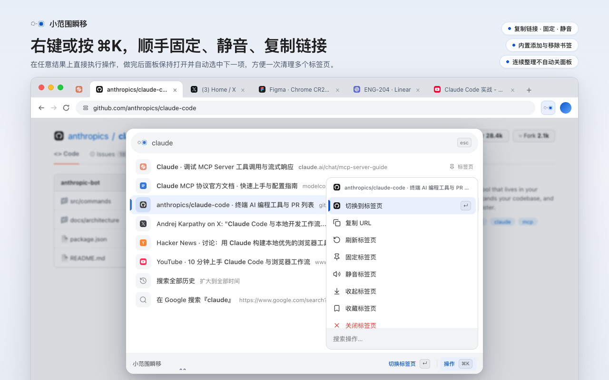

# 小范围瞬移 · 使用指南

[English](USAGE.md) · 简体中文 · [返回主页](../README.zh-CN.md)

欢迎阅读 **小范围瞬移**（JustOneHop）完整使用指南！小范围瞬移是一款为 Google Chrome 深度定制、顺应直觉的命令面板与标签页管理工具。

无论你习惯全键盘的指尖飞速流转，还是偏爱鼠标点选的惬意，抑或是在敲代码与浏览网页时随时在两者之间切换，小范围瞬移都能无缝承接你的节奏。

---

## 目录

- [1. 快速上手](#1-快速上手)
- [2. 统一搜索：瞬移至任何内容](#2-统一搜索瞬移至任何内容)
  - [标签页、书签与浏览历史一体检索](#标签页书签与浏览历史一体检索)
  - [日常搜索案例与组合技巧](#日常搜索案例与组合技巧)
  - [命令别名与智能容错](#命令别名与智能容错)
  - [网址直达与 Google 搜索](#网址直达与-google-搜索)
- [3. 最近标签页切换：像 VS Code 一样顺手](#3-最近标签页切换像-vs-code-一样顺手)
  - [按住、点按与松开即切换](#按住点按与松开即切换)
  - [10 秒配置专属 Ctrl+Tab](#10-秒配置专属-ctrltab)
  - [在切换过程中随时搜寻](#在切换过程中随时搜寻)
- [4. 标签页连续整理与快捷操作 (`⌘K`)](#4-标签页连续整理与快捷操作-k)
  - [为什么叫「连续整理」？](#为什么叫连续整理)
  - [原生标签组管理](#原生标签组管理)
  - [一键收藏标签页 (`⌘D`)](#一键收藏标签页-d)
- [5. 标签页收起 (Tab Tucking)：优雅地做减法](#5-标签页收起-tab-tucking优雅地做减法)
  - [手动收起单页](#手动收起单页)
  - [空闲时自动收起](#空闲时自动收起)
  - [一键找回与批量撤销](#一键找回与批量撤销)
- [6. 开发者利器：免开 DevTools 查看 Storage & Cookies](#6-开发者利器免开-devtools-查看-storage--cookies)
  - [双栏并排：左侧键名，右侧格式化预览](#双栏并排左侧键名右侧格式化预览)
  - [权限与隐私承诺](#权限与隐私承诺)
- [7. 导航、触控手势与显示形态](#7-导航触控手势与显示形态)
  - [44px 单行底栏与导航](#44px-单行底栏与导航)
  - [逐层返回与触控板双指滑动](#逐层返回与触控板双指滑动)
  - [网页浮层与独立伴侣窗口](#网页浮层与独立伴侣窗口)
- [8. 本地学习与习惯记忆](#8-本地学习与习惯记忆)
- [9. 完整快捷键与操作速查](#9-完整快捷键与操作速查)

---

## 1. 快速上手

<a id="使用帮助"></a>

### 唤起面板

在任何网页中按下默认快捷键，即可唤起小范围瞬移面板；也可以直接点击 Chrome 工具栏上的小范围瞬移图标：

```
macOS:         ⌘ + Shift + P
Windows/Linux: Ctrl + Shift + P
```

<picture>
  
</picture>

### 空搜索首页能做什么？

当你刚刚打开小范围瞬移、尚未输入任何字词时，展现在眼前的是精心编排的**首页推荐**：

- **Tab Switcher**：快速回到刚才浏览的标签页。
- **搜索全部历史**：从最近 7 天跨越到全量历史检索。
- **常用浏览器动作**：打开设置、使用帮助、新建标签页、刷新页面、固定或静音。
- **页面存储入口**：快速查看 Local Storage、Session Storage 与 Cookies。

> [!TIP]
> **查看实际快捷键或进入帮助**
> 随时右键点击 Chrome 工具栏上的小范围瞬移图标，即可查看当前生效的实际快捷键（若未绑定会有明确提示，点击可直接进入 Chrome 快捷键设置），或直接打开内置的使用帮助页。

---

## 2. 统一搜索：瞬移至任何内容

<a id="搜索与导航"></a>

无论是搜网页、搜书签、搜历史还是调出浏览器设置，直接在搜索框里输入你脑海中的词汇即可，支持中英文日常表达与常用别名：


### 标签页、书签与浏览历史一体检索

- **已打开的标签页**：输入网页标题或域名的任意字词，按回车直接切过去。
- **书签**：与标签页一同列出。单击或回车在当前页打开；按 **`⌘Enter`**（Windows/Linux 为 **`Alt+Enter`**）则在**新标签页中打开**。
- **浏览历史**：默认直接搜索最近一周的历史记录。若需查找更久之前的内容，选择第 7 项的「搜索全部历史」（或直接输入 `history`）即可深入全量历史。
- **Chrome 内置管理页**：输入 `扩展`（`extensions`）、`密码`（`passwords`）、`下载`（`downloads`）或 `浏览器设置`，直接跳到 Chrome 原生界面。若当前窗口已经打开过该内置页，会自动切换激活，不会多开重复标签。

### 日常搜索案例与组合技巧

| 你想做的事 | 搜索输入示例 | 匹配结果与效果 |
| --- | --- | --- |
| 找特定的 GitHub PR | `github pull` 或 `pr react` | 组合域名与标题字词，精准过滤多标签 |
| 查找 Notion 路线图 | `notion 路线` 或 `notion roadmap` | 中英文混合分词查询 |
| 调整深色模式 | `深色` 或 `dark mode` | 直接跳转设置并聚焦外观项 |
| 找回刚刚误关的页面 | `恢复标签` 或 `reopen` | 恢复最近关闭的标签页或窗口 |
| 快速清理右侧杂乱页面 | `关闭右侧` 或 `close right` | 执行关闭右侧标签页（固定标签页受保护） |

中文内容也支持**无声调拼音和连续首字母**：例如输入 `chanpinluxiantu`、`cplxt` 或 `notion luxian` 查找「产品路线图」。至少输入两个字母，可用空格组合拼音、中英文和数字，`ü` 用 `v`；字面命中始终排在拼音命中之前，使用习惯不会改变这个优先级。Tab Switcher 同样支持，命中处高亮原中文。

历史搜索保留原生字面检索，并在所选时间范围最近 1000 个页面中补充拼音匹配；达到检索上限会提示，较早的页面可改用中文原文查找。

#### 仓库/项目主页优先识别

如果你输入某个项目名（如 `justonehop`），当该词恰好匹配 URL 的末尾路径段且包含在标题中时，小范围瞬移会优先推荐该项目的主页，而不是深层的子文档；如果你想找子文档，只需再追加一个词，如 `justonehop testing` 即可。

### 补全以前用过的搜索词

成功使用过 `github` 后，在主搜索输入 `g`，剩余文字会以浅色提示。建议来自成功的本地选择、网址导航与网页搜索，综合考虑使用频次和最近使用时间。

- 光标在末尾时，按 **Tab** 或 **→**，或点击底栏「补全」，填入建议并继续输入。
- **继续搜索**：通过非空主搜索成功打开标签页、书签或历史结果，且当时至少有两个不同的可用页面时，10 分钟内在同一浏览器窗口重新打开面板，空输入也会提示上次查询。使用原有补全键或底栏「继续搜索」接受；输入匹配前缀时优先使用该查询，输入不匹配时回到普通补全。每个窗口仅保留最近一次符合条件的查询，到期、重置或重启浏览器后清除。命令、网址直达、Google 搜索和隐身操作不产生此提示。
- 接受前，列表仍按实际输入检索；**Enter** 执行当前结果，**↑ / ↓** 只移动结果选择。
- 没有提示时 Tab 照常移动焦点；**Shift+Tab** 始终反向导航。光标移到中间、选中文字、输入法组合期间或删除文字后，补全提示收起。
- 建议仅保存在本机，不推荐危险命令，隐身模式停用。在**设置 → 重置搜索排序**中可一并清除查询与排序习惯。仅输入文字或接受提示不会保存查询。

### 命令别名与智能容错

小范围瞬移为常用命令配备了贴心的别名白名单与日常错拼容错：

- **设置**：`prefs`, `setings`, `设置`, `偏好设置`
- **密码**：`pwd`, `passowrd`, `密码`
- **扩展**：`plugins`, `addons`, `extention`, `插件管理`
- **书签**：`favorites`, `favourites`, `收藏夹`
- **刷新**：`refesh`, `relaod`, `刷新`
- **历史**：`histroy`, `历史记录`
- **品牌直达**：`joh`, `justonehop`, `瞬移`, `小范围瞬移`

> [!NOTE]
> 容错别名经过严格的误触筛选。涉及关闭、删除等具有破坏性的危险操作始终需要明确的关键词或意图，绝不会因为轻微手滑误关你的重要网页。

### 网址直达与 Google 搜索

当你输入一段网址（例如 `github.com/trending` 或本地调试的 `localhost:3000`）时，首项会直接生成直达候选：

- 按 **`Enter`**（或点击底栏「当前页打开」）：在当前标签页导航。
- 按 **`⌘Enter`**（Windows/Linux **`Alt+Enter`**）：在新标签页打开并激活。

如果输入的关键词未匹配到本地标签或书签，小范围瞬移会为你提供「在 Google 搜索 “……”」：
- 回车直接在当前页发起搜索。
- `⌘Enter` / `Alt+Enter` 在新标签页发起搜索。

---

## 3. 最近标签页切换：像 VS Code 一样顺手

<a id="最近标签页切换"></a>

在代码编辑器（如 VS Code）中，`Ctrl+Tab` 是最爽快的切换体验。小范围瞬移将这种体验原汁原味地带进了 Chrome：

<picture>
  
</picture>

### 按住、点按与松开即切换

1. **按住修饰键不放**（macOS 默认 `Control`，Windows/Linux 默认 `Ctrl`）。
2. **点按触发键**（macOS 默认 `J`，Windows/Linux 默认 `,`；若配置了 `Ctrl+Tab` 则为 `Tab`）唤起切换器，光标立刻落在上一个标签页上。
3. **保持按住修饰键**，继续点按触发键（或使用方向键 `↑`/`↓`、`P`/`N`）在最近使用的标签页之间穿梭。
4. **松开修饰键**——瞬间瞬移到目标标签页！


### 10 秒配置专属 Ctrl+Tab

<a id="ctrltab-配置"></a>

由于 Chrome 官方对扩展快捷键的限制，`Ctrl+Tab` 无法在常规快捷键界面中直接敲击设置。为此，小范围瞬移内置了独创的一键配置向导：

1. 打开小范围瞬移，搜索 `ctrl tab`（或从「设置 → 快捷键 → Tab Switcher」进入）。
2. 点击底栏的「复制并打开」。小范围瞬移会自动生成绑定你本机扩展 ID 的配置脚本，并为你打开 Chrome 扩展快捷键设置页。
3. 在新打开的页面上按下控制台快捷键（macOS 为 **`⌘⌥J`**，Windows/Linux 为 **`Ctrl+Shift+J`**）。
4. 粘贴并回车。`Ctrl+Tab` 与反向的 `Ctrl+Shift+Tab` 便一次性全部绑定成功！

> [!TIP]
> 配置向导会在原标签页静静为你保留，你可以随时切回来查看步骤，不用担心走丢。

### 在切换过程中随时搜寻

标签页太多，要找 10 次前看过的网页？
在按住修饰键唤起切换器后，**用鼠标点击搜索框，或按下 `⌘F` (`Ctrl+F`)**。此时小范围瞬移会立刻暂停「松键即切换」模式，允许你松开手指，自如地输入标题或网址筛选，找到后按回车完成切换。

---

## 4. 标签页连续整理与快捷操作 (`⌘K`)

<a id="整理标签页与继续操作"></a>

普通的命令面板在执行完一个动作后往往直接关闭，整理标签页时不得不一遍又一遍地重新唤起。小范围瞬移彻底改变了这一点：


### 为什么叫「连续整理」？

在搜索结果列表中，右键任意标签页、点击底栏的「操作」按钮，或按下 **`⌘K`**（Windows/Linux 为 **`Ctrl+K`**），即可呼出针对该标签页的操作菜单：

<picture>
  
</picture>

- **固定 / 取消固定**
- **静音 / 取消静音**
- **刷新网页**
- **复制 URL**（一键拷贝纯净网址，不干扰当前工作流）
- **关闭标签页**（或关闭其他标签页、关闭右侧）
- **移入 / 移出标签组**

> [!IMPORTANT]
> **连续整理的魔力**
> 只要你操作的不是唤起面板的当前来源页，**小范围瞬移在完成操作后会稳稳保持打开**，并贴心地自动选中相邻的下一个结果。你可以一口气连续关闭、固定或静音 5 个页面，无需任何重复唤起！

### 原生标签组管理

深度打通 Chrome 原生 Tab Groups，告别臃肿的第三方抽屉：

- 直接在主搜索中输入标签组名称。
- 按回车或点击底栏「查看组内标签页」，即可进入该组专属列表，只筛选和查看组内网页。
- 在操作菜单（`⌘K`）中，你可以：
  - **展开 / 折叠** 分组
  - **重命名** 标签组（实时保存生效）
  - **解散分组（保留所有标签页）**：仅移除彩色外框，保留所有打开的网页
  - **关闭整个组**：贴心弹出确认弹窗，并清晰展示将要关闭的标签页总数（固定标签页始终受到保护）

### 一键收藏标签页 (`⌘D`)

<a id="收藏与取消收藏标签页"></a>

- 在主搜索中输入 `收藏标签页` 或 `bookmark`，快速将当前标签页保存至原生书签栏的「其他书签」。
- 在任意标签页的操作菜单（`⌘K`）中，按下 **`⌘D`**（Windows/Linux **`Ctrl+D`**），即可在不切过去的情况下直接将它收藏。
- 输入 `取消收藏` 或 `unbookmark`，可以安全地移除已有书签。

---

## 5. 标签页收起 (Tab Tucking)：优雅地做减法

<a id="收起标签页"></a>

每个人都经历过这样的烦恼：有些标签页待会儿可能还要用，舍不得关掉；可开得太多不仅让标签栏拥挤不堪，还会拖慢浏览器响应。**标签页收起**正是为此而生——它将页面无损移入 Chrome 原生的折叠组中（固定名称「收起来」），不关闭网页，也不丢失表单内容。

### 手动收起单页

- 在主搜索中输入 `收起标签页`（或 `tuck tab`），立刻将当前页收起，并平滑切至相邻页面。
- 也可以在任何标签页的 `⌘K` 操作菜单中选择「收起标签页」。

### 空闲时自动收起

进入「设置 → 实验功能 → 自动收起标签页」：

- 提供 **1 小时、12 小时、1 天、3 天、7 天** 五档时长调节（默认 7 天）。以前保存的 3 小时等非预设时长保留，直到重新选择。
- 电脑空闲（至少 60 秒没有鼠标键盘操作或已锁屏），或 **Chrome 连续失去焦点 30 分钟**后才收起到期标签。失焦路径使用每 5 分钟的例行检查；返回 Chrome 会重置等待并停止后续收起。
- 设置中区分未到期、受保护、到期待检查和恢复归属阻塞；上次尝试失败单独显示，成功检查后清除。
- **安全第一**：当前正在看的页面、固定标签页、正在播放声音的页面、已有自定义分组的页面、分屏页以及无痕窗口，**永远不会被自动收起**。
- 如果以后不需要，随时关闭该开关，所有被收起的页面会立即全部平铺移回普通标签栏。

同一窗口分多批收起的标签，会保持第一次收起前的左右顺序。手动调整组内顺序后，以你的调整为准；完整退出浏览器后，以恢复的标签栏顺序为新基准。撤销只返回最近一批，不恢复整个窗口的历史位置。

### 一键找回与批量撤销

- **找回单页**：想看某个收起的页面？直接在主搜索或 Tab Switcher 中搜到并切换过去，该页面便会自动离开折叠组、回到你的日常标签栏。
- **批量撤销**：输入 `撤销收起`（`undo tuck`），刚才收起的一整批标签页立刻完整复原。

---

## 6. 开发者利器：免开 DevTools 查看 Storage & Cookies

<a id="页面存储"></a>

作为前端开发者或极客，经常只是想看一眼某个 LocalStorage 存的 token，或者核对一个 Cookie 的过期时间，却不得不费力按 F12 打开笨重又占屏幕的 Chrome 开发者工具。小范围瞬移为你提供了秒级直达的只读检查器：

```
主搜索输入：local storage 或 本地存储
主搜索输入：session storage 或 会话存储
主搜索输入：cookie 或 cookies
```

### 双栏并排：左侧键名，右侧格式化预览

- **左侧面板**：快速检索与滚动浏览所有的 Key 或 Cookie 键名。
- **右侧面板**：实时展示完整 Value，JSON 格式化高亮排版，并清晰展示 Cookie 的域名、路径、过期时间、HttpOnly 及分区状态。
- 按 **`Enter`** 或点击底栏「复制值」，纯净的原始内容立刻拷贝至剪贴板，省去层层折叠展开的繁琐。

### 权限与隐私承诺

- `localStorage` 与 `sessionStorage` 依托 Chrome 的瞬时 `activeTab` 权限读取。
- Cookie 查看仅在你明确触发时**按网站逐个请求授权**，绝不滥用全网通配符。
- 数据仅在面板内存中供你查看与复制，绝不持久化存入数据库，更不会发生任何网络外传。

---

## 7. 导航、触控手势与显示形态

<a id="面板位置底栏与返回"></a>

小范围瞬移在每一个像素和交互细节上都追求原生与克制。

### 设置分类与搜索

点击首页底栏的「小范围瞬移」文字或搜索 `设置` 进入设置，通过左侧栏选择**外观、快捷键、实验室、帮助**；窄屏改用分类选择器。默认打开外观，语言、主题和搜索图标集中在这里；帮助分类直接显示帮助正文。顶部搜索在分类页和设置子页中始终可用，搜索范围覆盖全部设置。切换分类不会增加返回层级；点击设置搜索框左侧的旋转徽章或按 `Esc`，每次退回一层，已打开的菜单或确认层优先退出。需要搜索时直接点击输入框。

输入关键词会临时显示匹配项，清空后恢复原分类或子页及其草稿；从搜索结果打开子页后返回，会保留原检索上下文。自定义搜索图标位于**外观 → 搜索栏图标**，修改后需显式保存。临时搜索保留草稿，通过返回、分类导航或其他目标离开图标页则放弃未保存修改。分类、搜索、字段和操作均可用鼠标或键盘完成（`Tab` / `Shift+Tab` 移动焦点）。

### 44px 单行底栏与导航

每个界面底部都有高度恒定为 44px 的底栏：
- **左侧**：当前位置。设置分类与子页统一显示「设置」；切换分类使用侧栏，返回使用设置搜索框左侧的旋转徽章。历史、存储、标签组与面板内帮助也使用顶部旋转徽章返回，任务页在顶部提供相同入口。点击底栏小兔子显示／隐藏导航提示，提示随小兔子自动潜伏收起；外观设置可隐藏小兔子。独立帮助窗口保留关闭入口，Tab Switcher 保留专用搜索与取消操作。
- **右侧**：当前候选最关键的操作按钮（如「当前页打开」、「新标签页打开」、「操作 (⌘K)」）。

### 逐层返回与触控板双指滑动

进入多级子页面或操作菜单时，永远不会迷失方向：
- 按 **`Esc`** 或点击当前页面的返回入口，每次只退回最深的一层，并完整保留上一层的搜索词、选中项光标与滚动位置。
- 在空搜索框中按下 **`Backspace`**，同样平滑返回上一层。
- **触控板双指右滑（macOS）**：在面板内像原生网页手势一样轻轻右滑，即可返回上一层；在主搜索层右滑则轻巧关闭面板。

### 网页浮层与独立伴侣窗口

为了让你在任何地方都能稳定使用，小范围瞬移支持两种无缝承载形态：
1. **网页浮层模式**：在普通 HTTP(S) 网页上，面板相对页面视口水平居中、偏上显示。
2. **独立伴侣窗口模式**：在 Chrome 禁止扩展注入脚本的特殊页面（如 `chrome://` 设置、Chrome Web Store 或空白页），小范围瞬移打开轻量独立窗口，面板内容相对来源浏览器窗口水平居中、偏上显示。

命令面板与 Tab Switcher 共用这些规则。两种承载各有定位锚点，屏幕位置可以不同，也不会固定在显示器的某个位置。内容尺寸随来源标签页视口与页面缩放适配，原生标题栏和边框另占空间。

---

## 8. 本地学习与习惯记忆

随着你的使用，小范围瞬移会越来越懂你：

- 当你搜索某个关键词并选择了结果后，小范围瞬移会在本机轻量记录你的偏好。
- 下次再输入该关键词时，该结果会在**其所属的相关性分级内**适度前移（相关性始终优先，绝不会让无关的模糊匹配强行盖过精准标题）。
- **透明可控**：受到本地学习提升的结果右侧会显示一个小巧的历史钟表图标。鼠标悬停能看到它为何被推荐；点击图标上的 `×`，或直接按下 **`Shift+Backspace`**，即可单键遗忘该偏好。
- **100% 留在本机**：学习权重每 14 天衰减一半，90 天未使用的记录自动清理。数据绝不上云。

---

## 9. 完整快捷键与操作速查

### 全局与面板基础导航

| 操作 | 鼠标 / 手势 | macOS 快捷键 | Windows / Linux |
| --- | --- | --- | --- |
| **打开 / 关闭小范围瞬移** | 点击工具栏图标 | `⌘ + Shift + P` | `Ctrl + Shift + P` |
| **退出或逐层返回** | 点击返回入口 / `esc` 键帽 | `Esc`（搜索框为空时 `Backspace`） | `Esc`（搜索框为空时 `Backspace`） |
| **上下移动选择** | 滚轮滚动 / 点击目标行 | `↓` / `↑`（或 `Ctrl+N` / `Ctrl+P`） | `↓` / `↑`（或 `Ctrl+N` / `Ctrl+P`） |
| **跳到列表首尾** | 滚动到顶 / 到底 | `⌘ + ↑` / `⌘ + ↓` | `Ctrl + Home` / `Ctrl + End` |
| **按页翻滚 (PageUp/Down)** | 滚轮滑动 | `⌥ + ↑` / `⌥ + ↓`（或 `PageUp`/`Down`） | `Alt + ↑` / `Alt + ↓` |
| **执行选中项** | 单击候选项 | `Enter` | `Enter` |
| **在新标签页打开** | 点击底栏「在新标签页打开」 | `⌘ + Enter` | `Alt + Enter` |
| **打开操作菜单** | 右键候选项 / 点击底栏「操作」 | `⌘ + K` | `Ctrl + K` |
| **打开设置** | 点击首页底栏「小范围瞬移」文字 | `⌘ + ,` | `Ctrl + ,` |
| **忘记当前项的习惯记录** | 点击历史图标上的 `×` | `Shift + Backspace` | `Shift + Backspace` |
| **触控板双指滑动返回** | 触控板双指右滑 | — | — |

### 最近标签页切换 (Tab Switcher)

| 操作 | 鼠标 | macOS 快捷键 | Windows / Linux |
| --- | --- | --- | --- |
| **唤起切换器** | 首页点击「Tab Switcher」 | 按住 `Control` + 按 `J` | 按住 `Ctrl` + 按 `,` |
| **穿梭最近标签** | 点击候选行 | 点按触发键 / `↓` / `↑` / `N` / `P` | 点按触发键 / `↓` / `↑` / `N` / `P` |
| **确认切换** | 单击候选行 | 松开修饰键 | 松开修饰键 |
| **取消切换** | 点击空白处或 `esc` | `Esc` | `Esc` |
| **切入搜索筛选** | 点击顶部搜索框 | `⌘ + F` | `Ctrl + F` |

---

*感谢你使用小范围瞬移！如果你在日常使用中有任何反馈或灵感，欢迎随时在 [GitHub 仓库](https://github.com/lyyourc/JustOneHop) 提出 Issue 与交流。*
