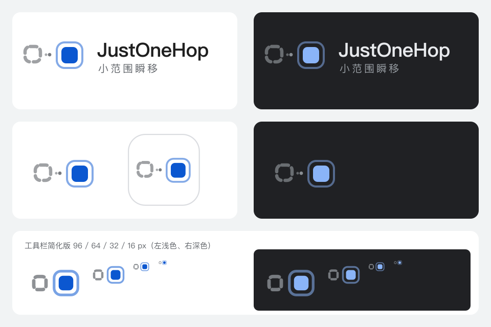

# JustOneHop · 小范围瞬移 · Logo 规范

完整版与小尺寸版保持相同的左右关系；以下为实际使用的小尺寸资源。

 

## 1. 设计理念

名字的核心是 **「小范围」＋「瞬移」**。瞬移不是赶路：没有路径，只有「这里消失、那里出现」。标志因此**没有箭头和弧线**，只画两个状态：

> 在这里消散，在旁边出现。

| 元素 | 含义 |
| --- | --- |
| 左侧灰色虚线方块 | 起点：刚离开的标签／页面，正在消散，只剩轮廓碎片 |
| 中间两颗渐大的小点 | 消散的粒子「一闪而过」：短暂，不连成路径 |
| 右侧实心蓝色方块 | 落点：现在到达的目标，**唯一的重点** |
| 落点外的一圈半透明环 | 「落地」的涟漪，强调到达 |
| 两者并排、间距小 | 小范围：目标就在身边 |

与产品原则的对应：

- **Just One Hop**：只有「离开」与「到达」两个状态；灰为过去，蓝为现在。
- **Human First**：直观，不需要记忆符号含义。
- **Chrome Native**：无底板的单色图形、柔和蓝与灰，圆角方块呼应 Chrome 标签与 Omnibox 的圆角语言；无渐变、无阴影。
- **Local & Honest**：只表达位置切换；起点是变淡而非被叉掉，对应「收起不是关闭」。

## 2. 色彩：蓝色只给落点

| 元素 | 浅色背景 | 深色背景 |
| --- | --- | --- |
| 落点方块 | `#0b57d0` | `#8ab4f8` |
| 涟漪环 | 落点色 @50% | 落点色 @50% |
| 起点虚线 | `#5f6368` @60% | `#9aa0a6` @60% |
| 粒子 | 起点色 @55% / @85% | 同左 |
| 文字 | `#1f1f1f` | `#e8eaed` |
| 辅助文字 | `#5f6368` | `#9aa0a6` |

蓝色（落点＋涟漪）只占图形的一小部分，其余为中性灰。不使用渐变、阴影、发光，也不使用满铺蓝底板。蓝色以 `src/style.css` 中的 `--accent` 为准，界面主色调整时同步调整此处。

## 3. 构成与几何（128 × 128 网格）

### 完整版（≥ 48 px、商店、文档）

| 元素 | 参数 |
| --- | --- |
| 起点方块 | x9 y48，30 × 30，圆角 10，描边 **6.5**，虚线 `13 8`，圆头，无填充 |
| 粒子 | (50, 64) r2.6；(57, 64) r3.4 |
| 落点方块 | x80 y49，32 × 32，圆角 9，实心 |
| 涟漪环 | x71 y40，50 × 50，圆角 15，描边 **4** |
| 安全区 | 图形四周至少 ½ 个落点方块（16 单位） |

### 工具栏与搜索框简化版

保持左侧消散起点、右侧落点与涟漪的横向构图。品牌结构优先于图标槽的填充率；不得为增大小尺寸有效高度而移动元素、改为对角排布或非等比拉伸。

| 元素 | 参数 |
| --- | --- |
| 起点方块 | x8 y47，32 × 34，圆角 10，描边 **9**，虚线 `17 10`，不透明度 70% |
| 粒子 | **去掉** |
| 落点方块 | x73 y45，38 × 38，圆角 11 |
| 涟漪环 | x61 y33，62 × 62，圆角 18，描边 **7**，不透明度 55% |

## 4. 文件与使用

| 文件 | 用途 |
| --- | --- |
| [logo-light.svg](logo-light.svg) | 浅色背景（文档、网页、浅色界面） |
| [logo-dark.svg](logo-dark.svg) | 深色背景 |
| [logo-small-light.svg](logo-small-light.svg) | 16 / 32 px 工具栏简化版，**构建使用** |
| [logo-small-dark.svg](logo-small-dark.svg) | 工具栏深色版，**构建使用** |
| [logo-app.svg](logo-app.svg) | 48 / 128 px 与商店：白色圆角底板（细灰边）＋完整版，**构建使用**；唯一允许的底板形式 |
| [logo-mono.svg](logo-mono.svg) | 单色（`currentColor`）：靠不透明度区分主次，用于单色场景 |
| [logo-lockup.svg](logo-lockup.svg) / [logo-lockup-dark.svg](logo-lockup-dark.svg) | 横向组合：图形 + JustOneHop + 小范围瞬移 |
| [sheet.svg](sheet.svg) / [sheet.png](sheet.png) | 规范预览总览 |

- **构建**：[build.mjs](../../build.mjs) 从 SVG 裁去透明边后等比生成工具栏 PNG，保持原构图：`icon16/32.png` 与 `icon16/32-dark.png` 为小图标；`toolbar48/128.png` 及其 `-dark` 版用于高密度工具栏；`icon48/128.png` 为管理页白底完整版。搜索框直接复用小尺寸 SVG，按面板主题配色。
- **主题**：本地离屏页面监听系统 `prefers-color-scheme`，由后台 `chrome.action.setIcon` 切换工具栏资源；需要 `offscreen` 权限。面板关闭时仍更新，不跟随面板手动主题，也不能识别 Chrome 自定义工具栏配色。详见 [ADR 0023](../adr/0023-logo.md)。
- **组合标志**：英文名字号约 0.34H（H 为图形高度），字重 600；中文名字号约 0.16H、字间距 4、字重 400；字体优先 Google Sans → 系统无衬线（PingFang SC 等）。正式发布前需把文字转为轮廓。
- **最小尺寸**：工具栏 16 px（使用简化版）；完整版 48 px；组合标志高度 32 px。

## 5. 禁止

- 加回箭头、弧线或连续轨迹线（那是「搬运」，不是「瞬移」）。
- 使用满铺蓝底板；除商店白底板外不加其他底板。
- 把起点也涂成蓝色或让起点与落点同样实心（失去「过去／现在」主次）。
- 把两者拉远，或在中间加入其他元素（失去「小范围」）。
- 拉伸、旋转、倾斜、加阴影或渐变；改用非规范色。
- 在 16 / 32 px 使用完整版（粒子与细环会糊）。
- 在图形旁添加 slogan 或额外文字。

## 6. 命名与语气

- 英文名：**JustOneHop**（一个词，J、O、H 大写）。
- 中文名：**小范围瞬移**。
- 文案保持安静、直接，与「收起不是关闭」「本机、诚实」一致，不使用夸张营销用语。

## 7. 验证状态

本轮构图与主题链路的实际检查见 [验收记录](../ACCEPTANCE.md)。输出像素覆盖范围与隔离浏览器内的切换验证，不等同于日常 Chrome 工具栏、扩展管理页或商店的人工验收。
